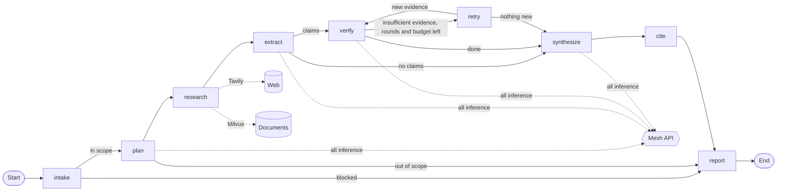

# DeepDive AI — Self-Verifying Multi-Agent Research Analyst

DeepDive AI answers research questions with findings that are checked **claim by claim** against the exact
evidence they cite. It plans the research, gathers evidence from the web and/or your own documents, extracts
atomic claims, verifies each one with an independent model and deterministic rules, retries where evidence is
missing, and reports only what survived verification, with a full audit trail.

Built for Krish Naik Agent Arena 2026. All AI inference runs through [Mesh API](https://developers.meshapi.ai).

## Problem and motivation

LLM research assistants write fluent answers whose citations often do not say what the answer claims. Readers
cannot tell which sentences are grounded, which are inferred and which are invented. DeepDive treats every
statement as a claim that must earn its place: a verbatim quote, from a passage the verifier actually saw,
that states the claim's facts and numbers. Anything that fails is shown as unresolved or contradicted, never
as a finding.

## Key capabilities

| Capability | What DeepDive does |
|---|---|
| **Claim extraction and verification** | Splits evidence into atomic claims (max 8); an independent verifier model judges each claim against each passage |
| **Rejection of unsupported evidence** | Accepts a judgment only if the quote is verbatim in the passage, contains the claim's numbers, does not negate it and covers its key terms |
| **Targeted research retries** | Searches again only for claims with insufficient evidence (max 2 rounds) |
| **Source-quality scoring** | Deterministic tiers (Primary · Strong secondary · General secondary · Unverified) used for ranking and display, never as proof |
| **Contradiction detection** | Claims with accepted contradicting evidence are *contradicted*; evidence on both sides is *unresolved (conflicting)*, shown side by side |
| **Citation integrity** | Report sentences may only restate supported claims: no added numbers, rankings, causes, risk labels or forecast-to-fact changes; otherwise the verified claim text is shown |
| **Transparent audit trail** | Every agent hand-off, rejected judgment, retry, Mesh call, token count, latency and cost basis is recorded |
| **Conversational follow-up** | Reuses the previous question's accepted evidence within the session (filtered by source and domain) and re-verifies everything |
| **Markdown report export** | Findings, forecasts, requested coverage, evidence table, excluded claims, limitations and audit summary |

## Architecture

Nine LangGraph nodes ([`graph_builder/research_graph.py`](graph_builder/research_graph.py)), each a focused agent:



| Node | Agent | Responsibility |
|---|---|---|
| `intake` | Intake | Loads the domain configuration; deterministic scope, length and source checks (no model call) |
| `plan` | Planner | Scope verdict and up to 4 sub-questions; rewrites follow-ups as self-contained questions |
| `research` | Researcher | Web search (Tavily) and/or document search (Milvus, one batched embedding), with URL or page provenance |
| `extract` | Claim extractor | Up to 8 atomic claims tied to evidence IDs, typed (fact, quantity, date, forecast, …) |
| `verify` | Verifier | Independent judgments per (claim, passage) by a different model; status computed by rules |
| `retry` | Targeted retry | New evidence only for claims still insufficient (bounded rounds) |
| `synthesize` | Synthesizer | Writes the answer from **supported** claims only |
| `cite` | Citation checker | Validates every sentence and citation; falls back to verified claim text |
| `report` | Reporter | Builds the report, coverage statement and audit summary with an honest status |

Key design decisions:
- Model confidence is never an input: claim status is computed by code from validated judgments.
- Different models plan and generate (`openai/gpt-4o-mini`) and verify (`google/gemini-2.5-flash`).
- Every run is bounded by a budget, and retries count as calls.

More detail: [docs/ARCHITECTURE.md](docs/ARCHITECTURE.md).

## Claim-level verification and targeted retry

| Status | Rule |
|---|---|
| `supported` | Enough independent sources (distinct documents or web hosts) with an accepted supporting quote, and no accepted contradiction |
| `contradicted` | Accepted contradicting evidence and no accepted support |
| `unresolved` | Evidence on both sides, or still insufficient after the final retry or a budget stop |
| `insufficient_evidence` | Not enough accepted evidence yet; triggers a targeted retry |

A verifier judgment is **rejected** if:
- the evidence ID was not shown for that claim;
- the quote is not verbatim in the passage (after strict Unicode and whitespace normalisation);
- a supporting quote lacks one of the claim's numbers;
- the quote negates the claim;
- the quote shares too few of the claim's key terms.

Rejected judgments stay visible with their reasons. Claims still `insufficient_evidence` are searched again
using their own text; new passages are verified the same way.

## Research modes

| Sources (sidebar) | Searches | Use for |
|---|---|---|
| **Web only** (default) | Tavily | Any topic; no indexed documents needed |
| Documents only | Milvus | Research grounded only in your uploaded PDFs; web is never added |
| Documents + Web | both | Combining your documents with public sources |

Web findings cite an actual URL and show the retrieval date, plus the publication date when the search
provider reports one. Projections are shown separately as **forecasts**, never as observed outcomes.

## Domains and example questions

Domains are YAML files in [`domains/configs/`](domains/configs/). They set scope, claim types, high-risk types
and source requirements.

| Domain | Example question | High-risk claims |
|---|---|---|
| General | "What are the three biggest growth opportunities and commercialization risks for India's defence-tech startups through 2030?" | none |
| Procurement | "Review supplier X: contract term, delivery performance and certifications." | compliance, sanctions (human review) |
| Supply chain | "What disruptions affected lithium-ion cell supply in 2025?" | disruption, compliance (human review) |
| Pharma | "What efficacy did the phase 3 trials of drug X report?" | efficacy, safety, dosage, regulatory (**2 independent sources** + human review) |
| Insurance | "What does policy wording X exclude for flood damage?" | coverage, claims, compliance, pricing (**2 independent sources** + human review) |

## Mesh API: mandatory routing

**All AI inference goes through Mesh API.** That covers chat, structured output and embeddings, via one
module, [`gateway/mesh.py`](gateway/mesh.py), with no fallback provider.
[`tests/test_mesh_compliance.py`](tests/test_mesh_compliance.py) enforces this, and `requirements.txt` lists
no other provider SDKs (`langchain-openai` is used only as the OpenAI-compatible Mesh client). Tavily is a
search provider only; it never generates answers.

Per research run (configurable in `.env`):
- 25 LLM calls · 10 embedding calls · 8 web searches · 30 tool calls · 2 retry rounds · 300 s;
- an estimated US$0.50 Mesh budget, which is not a guaranteed cap.

Costs are labelled **reported**, **estimated** (tokens × [`config/mesh_pricing.yaml`](config/mesh_pricing.yaml))
or **unknown**, and marked incomplete when a token type has no configured rate.

## Installation and configuration

Python 3.11 or 3.12.

```bash
python -m venv .venv && source .venv/bin/activate
pip install -r requirements.txt
cp .env.example .env      # add your keys locally; .env is git-ignored
```

| Variable | Required for |
|---|---|
| `MESH_API_KEY` | All runs |
| `TAVILY_API_KEY` | Web only, Documents + Web |
| `MILVUS_ENDPOINT`, `MILVUS_API_KEY`, `MILVUS_COLLECTION` | Documents only, Documents + Web, PDF upload |
| `MESH_MODEL_SUPERVISOR`, `MESH_MODEL_GENERATOR`, `MESH_MODEL_VERIFIER` | Optional; default to `openai/gpt-4o-mini`, `openai/gpt-4o-mini`, `google/gemini-2.5-flash` |
| `MAX_*` | Optional budget overrides (see [`.env.example`](.env.example)) |

## Running

```bash
streamlit run app.py                                # research UI
uvicorn api.main:app --host 127.0.0.1 --port 8000   # FastAPI service (GET /health)
pytest                                              # offline test suite: network blocked, no keys needed
```

In the UI, choose a domain and sources in the sidebar (optionally paste claims to fact-check), then ask a
question. Results appear in four tabs:
- **Report:** findings, forecasts, coverage, exclusions and the Markdown download.
- **Claims:** status, rule and rejected evidence.
- **Evidence:** quote, URL or page, source quality and dates.
- **Audit:** trace, retries, Mesh calls and cost.

Turn on **Follow-up** to build on the previous answer.

## Evaluation methodology and results

All figures come from recorded result files in [`evals/results/`](evals/results/). The samples are small:
they describe observed behaviour and are **not** statistically reliable accuracy measurements. Reruns are not
counted as separate questions.

**Offline:** 336 tests pass with the network blocked and scripted Mesh fakes. They cover workflow logic,
verification rules, citation integrity, budgets, UI and Mesh compliance; they do not measure model accuracy.
They include 17 deterministic rule cases ([`evals/datasets/verification_rules_v1.jsonl`](evals/datasets/verification_rules_v1.jsonl)).

**Document-grounded live evaluation:** 10 labelled questions over a sample index of four public Transformer
papers ([summary](evals/results/SUMMARY.md)).

| Measure | Result |
|---|---|
| Questions passing (first / latest attempt) | 8 / 10 · 9 / 10 (11 observations; L08-r1 is a rerun) |
| Fact-check claim-status agreement | 6 / 7 |
| Unsupported-claim leakage · citation-integrity failures | 0 / 10 sentences · 0 / 30 citations |
| False negatives | 1 (L06: supporting passage not retrieved) |
| Mesh requests · estimated cost | 53 · ≈ US$0.13 (incomplete) |

**Streamlit research and follow-up (B4):** two questions through the real UI, 20 Mesh requests, 2 web searches,
≈ US$0.10.
- **Research question:** passed (7 verified findings).
- **Follow-up:** partial. Evidence reuse and re-verification worked, but the "8 attention heads" answer was
  rejected by the key-term rule, a false negative. A fix for this was later tested offline and has not been
  measured live.

**Live Web-only research (GR1):** one open-topic question (India defence-tech opportunities and risks):
**partial pass**.
- **Claims:** 8 extracted, 6 supported, 2 unresolved.
- **Coverage (manual review):** 3 of 3 opportunities (one only indirectly) and 1 of 3 risks.
- **Usage:** 7 Mesh requests, 8 Tavily searches, 0 embeddings, ≈ US$0.033 (incomplete), 0 citation-integrity
  failures ([recorded result](evals/results/20261017_GR1_web_only_results.json)).
- **Manual review findings:** generated sentences added unsupported rankings and one invented risk.

**GR1 synthesis remediation:** the grounding check and coverage statement were added in response. They are
tested offline on GR1's recorded sentences and have **not** been re-measured live.

## Limitations and responsible use

- Verification checks that a quote states a claim. It cannot judge whether a source is right. Most web sources
  are unverified secondary sources, and web quotes are checked against search snippets, not full pages.
- The grounding check is conservative and lexical. It rejects visible additions, but it cannot prove that an
  accepted sentence is entailed. Claim-level over-acceptance, where a claim adds context its quote lacks,
  still depends on the verifier model.
- Research is bounded (4 sub-questions, 8 searches, 8 claims). Answers summarise what was retrieved; they are
  not exhaustive market research. Coverage counts a claim toward a category only if the claim uses that word.
- Strict rules sometimes reject valid paraphrased support (false negatives are reported as unresolved).
- Not for personal medical, legal or financial advice. High-risk domain claims are flagged for human review.
  Verify important decisions against primary sources.

## Copyright and licensing

DeepDive AI source code is publicly available for evaluation as part of Agent Arena 2026.
Copyright © 2026 Rahul Agarwal. All rights reserved. No open-source license is granted for the DeepDive-owned
code. Third-party components remain subject to their respective licenses. See [COPYRIGHT.md](COPYRIGHT.md).

PDF ingestion uses PyMuPDF, which is licensed AGPL-3.0 (or commercially by Artifex). Running, redistributing or
hosting DeepDive with PDF ingestion enabled must comply with PyMuPDF's terms.
