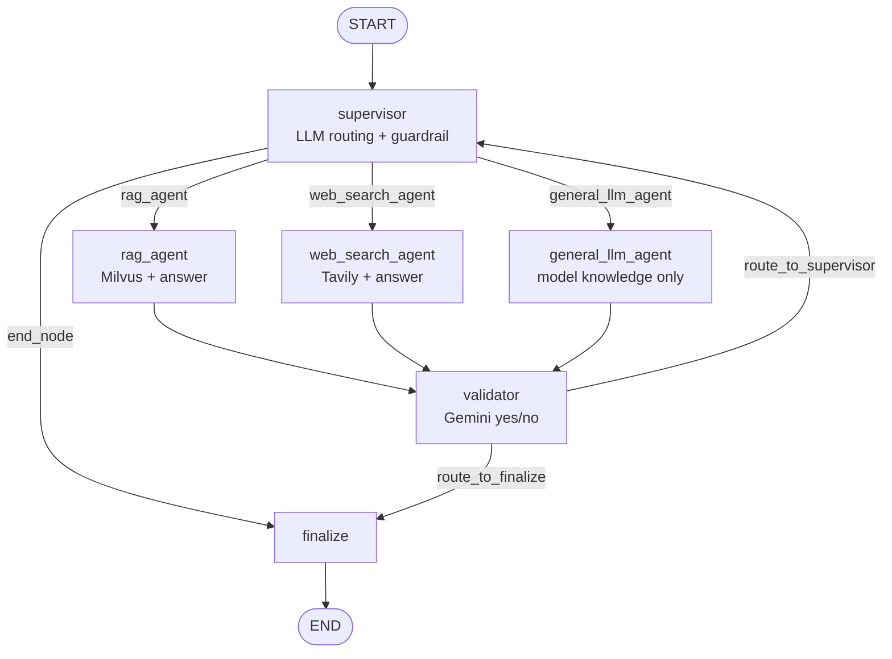

# DeepDive AI — Current Architecture Assessment

| | |
|---|---|
| **Status** | Draft — Phase 0 (read-only assessment), pending review |
| **Date** | 2026-10-16 |
| **Baseline** | Commit `22562cf` — "Initial DeepDive project from AIResearchAssistant" |
| **Related** | [Target architecture](target-architecture.md) · [Technical decisions](technical-decisions.md) · [Implementation roadmap](../roadmap/implementation-roadmap.md) |

This document describes what the repository does **today**. Everything here was observed directly in the code at the baseline commit or in the public Mesh API documentation. The design we propose is in the [target architecture](target-architecture.md).

---

## 1. Summary

DeepDive is currently a compact prototype (≈1,700 lines of Python) of an **answer-level RAG chatbot**:

- A LangGraph supervisor routes each question to **one** of three agents: document RAG over Milvus, Tavily web search, or an answer from the model's built-in knowledge alone.
- A Gemini judge then returns a single yes/no verdict for the **whole answer**. A "no" loops the graph back to the supervisor.
- A single-page Streamlit app handles PDF upload and chat.

**What is absent:**

- claim-level verification
- a relational database
- LangGraph checkpointing
- automated tests
- Mesh API usage

All model inference goes **directly to OpenAI and Google Gemini**.

The ingestion and retrieval building blocks are worth reusing: PyMuPDF/Camelot extraction, the LangChain chunker, the Milvus connection and the MMR reranker. The orchestration core cannot represent claims, evidence or targeted retries and needs to be replaced. That core is the supervisor, the validator and the state schema.

---

## 2. Scope and method

- Every Python module, `requirements.txt`, `.gitignore` and the repository layout were read. Secret values were not read or recorded.
- The application was **not** run, no dependencies were installed and no files were modified.
- The Mesh API integration pattern was cross-checked against a sibling project in the same workspace (`../AgenticAI_3/Middleware/MiddlewarePrebuilt.py`) and the public Mesh developer documentation (developers.meshapi.ai). Findings from that documentation are labelled as such and summarised in [technical-decisions.md](technical-decisions.md#5-mesh-api-capability-verification).

---

## 3. Repository layout

```
DeepDive/
├── app.py                      # Streamlit UI (actual entry point)
├── main_pipeline.py            # PDF → chunks → embeddings → Milvus
├── test_retriever.py           # manual retrieval script (not pytest)
├── requirements.txt            # unpinned
├── agents/                     # LangGraph node functions + state
│   ├── state_node.py           # AgentRagState, TopicSelectionParser
│   ├── supervisor_node.py      # LLM router + domain guardrail
│   ├── router.py               # conditional edge after supervisor
│   ├── rag_node.py             # Milvus retrieval + answer generation
│   ├── web_node.py             # Tavily search + answer generation
│   ├── llm_node.py             # answer from model's own knowledge (no documents)
│   ├── validation_node.py      # Gemini whole-answer judge
│   ├── validation_router.py    # conditional edge after validator
│   └── final_response_node.py
├── graph_builder/graph_builder.py   # StateGraph wiring, compiled at import
├── config/config.py            # env loading, model factory
├── pdf_processing/             # extractor, table/image extractors, chunking, embeddings
├── retriever/                  # Milvus search + MMR / BM25 rerankers
├── vector_database/            # Milvus collection + index helpers
├── monitoring/logger.py        # file logger → logs/system.log
├── prompts/" prompt_template.py"   # empty; filename begins with a space
├── ui/streamlit_app.py         # empty
└── outputs/                    # empty directory
```

---

## 4. Current runtime architecture

### 4.1 Research graph (observed)

Defined in [graph_builder/graph_builder.py](../../graph_builder/graph_builder.py) and compiled when the module is imported (`app = workflow.compile()`, no checkpointer).



**State** ([agents/state_node.py](../../agents/state_node.py)) is a `TypedDict`:

- `messages`: append reducer
- `retrieved_docs`
- `query`
- `validation_metadata`: typed `List[dict]`, but used as a `dict`
- `final_response`
- `next_step`
- `loop_count`

**Routing decisions:**

| Decision point | Mechanism | Location |
|---|---|---|
| Out-of-scope pre-check | Static keyword list | [supervisor_node.py:51-59](../../agents/supervisor_node.py#L51-L59) |
| Agent selection | LLM + `PydanticOutputParser(TopicSelectionParser)` | [supervisor_node.py:128-171](../../agents/supervisor_node.py#L128-L171) |
| Retry mode | If the validator said "no", RAG is forbidden; choose web or model-knowledge-only | [supervisor_node.py:107-124](../../agents/supervisor_node.py#L107-L124) |
| Circuit breaker | `loop_count > 2` → force web search | [supervisor_node.py:33-46](../../agents/supervisor_node.py#L33-L46) |
| Post-validation | `is_valid == "yes"` → finalize, else supervisor | [validation_router.py](../../agents/validation_router.py) |

### 4.2 Ingestion flow (observed)

[app.py:69-110](../../app.py#L69-L110) → [main_pipeline.py](../../main_pipeline.py):

1. The upload (≤10 MB, PDF only) is saved as `data/raw_pdfs/<original filename>`.
2. `PDFTextExtractor` (PyMuPDF) produces one record per page with `{source: filename, page, content}`.
3. `PDFTableExtractor` (Camelot) writes CSVs to `data/extracted/tables/`. **They are not indexed.**
4. `PDFImageExtractor` (PyMuPDF) writes images to `data/extracted/images/`. **They are not indexed.**
5. `DocumentBuilder` → LangChain `Document`. `TextChunker` uses chunk size 500 and overlap 100, hard-coded; the `Config.CHUNK_SIZE`/`CHUNK_OVERLAP` values are unused.
6. `EmbeddingGenerator` calls OpenAI `text-embedding-3-small` **directly** (1536 dimensions).
7. `MilvusDB.create_collection("ai_research_assistant")` → `create_hnsw_index` on every run → `insert` → `load`.

Deduplication exists only within a browser session (`st.session_state["processed_<name>"]`). Re-uploading the same file in a new session inserts duplicate vectors.

### 4.3 Retrieval (observed)

[retriever/retriever_pipeline.py](../../retriever/retriever_pipeline.py):

- creates a new `MilvusClient` and loads the collection **every time `RagAgent` runs**
- embeds the query with OpenAI directly
- searches L2/HNSW (`ef=64`, `fetch_k=10`), fetching the stored vectors
- applies MMR ([retriever/reranker.py](../../retriever/reranker.py)) to select `top_k=5`

Results carry `text`, `source` (filename) and `page`. `RagAgent` then drops `page` before it reaches the UI ([rag_node.py:63](../../agents/rag_node.py#L63)).

**Milvus schema** ([vector_database/milvus_setup.py:45-51](../../vector_database/milvus_setup.py#L45-L51)): `id INT64 auto`, `embedding FLOAT_VECTOR(1536)`, `text VARCHAR(10000)`, `source VARCHAR(500)`, `page INT64`. The schema has no document ID, version, chunk ID, tenant or access-control fields.

### 4.4 User interface (observed)

[app.py](../../app.py) is a single Streamlit page:

- **Sidebar:** uploader plus an "Active Agents Monitor", a list of free-text log strings.
- **Main area:** chat that calls `agent_graph.invoke(...)` synchronously, with no streaming.
- **Sources expander:** lists unique source file names or URLs only, with no page, quote or link.

History lives only in `st.session_state` and is lost when the browser session ends. [ui/streamlit_app.py](../../ui/streamlit_app.py) is empty.

### 4.5 Persistence (observed)

| Store | What | Durable? |
|---|---|---|
| Milvus / Zilliz Cloud | Chunk vectors + text + filename + page | Yes (external) |
| `data/raw_pdfs/`, `data/extracted/` | Uploaded PDFs, table CSVs, images | Local disk only |
| `logs/system.log` | Plain-text application log | Local disk only |
| `st.session_state` | Chat history, processed-file flags, UI logs | No — browser session |
| SQLite / PostgreSQL / SQLAlchemy / Alembic | — | **Not present** |
| LangGraph checkpointer | — | **Not present** |

`.gitignore` already excludes `.env*`, `*.db`, `*.sqlite*`, `data/`, `uploads/` and `*.log`.

### 4.6 Observability and testing (observed)

- [monitoring/logger.py](../../monitoring/logger.py) writes unstructured text to `logs/system.log`. Several modules use `print` instead.
- Logs include **full retrieved document text and web search results** ([rag_node.py:31](../../agents/rag_node.py#L31), [web_node.py:36](../../agents/web_node.py#L36)).
- No token, cost or latency capture beyond one retrieval timer.
- No LangSmith configuration.
- No pytest suite. [test_retriever.py](../../test_retriever.py) is a manual script that needs live Milvus and OpenAI.

---

## 5. Model inference integrations (observed)

Every runtime inference call bypasses Mesh API:

| # | Location | Provider / call | Used by |
|---|---|---|---|
| 1 | [config/config.py:28-31](../../config/config.py#L28-L31) | OpenAI `gpt-4o-mini` via `init_chat_model`; writes `OPENAI_API_KEY` into `os.environ` | supervisor, rag, web, general-llm nodes |
| 2 | [agents/validation_node.py:2,17](../../agents/validation_node.py#L17) | Google `ChatGoogleGenerativeAI("gemini-2.5-flash")`, created **when the module is imported** | validator |
| 3 | [pdf_processing/embeddings.py:6](../../pdf_processing/embeddings.py#L6) | OpenAI `OpenAIEmbeddings("text-embedding-3-small")` | ingestion + retrieval |
| — | [requirements.txt](../../requirements.txt) | `langchain-groq`, `langchain-anthropic`, `langchain_huggingface`, `sentence-transformers` installed but unused | latent bypass paths |

Notes:

- `langchain-google-genai` is imported but missing from `requirements.txt`.
- `Config.get_llm_validation` is missing `@classmethod` and refers to a commented-out constant, so it is broken but unused.
- Tavily ([agents/web_node.py](../../agents/web_node.py)) is a search API, not model inference. Whether it is permitted under the hackathon rules is an open question ([OQ-01](technical-decisions.md#4-open-questions)).

**Reference pattern for Mesh (observed outside this repo).** `../AgenticAI_3/Middleware/MiddlewarePrebuilt.py` uses `ChatOpenAI(base_url="https://api.meshapi.ai/v1", api_key=MESH_API_KEY, model=MESH_MODEL)`. Mesh's documentation describes the same OpenAI-compatible base URL and Bearer-key authentication.

---

## 6. Gap analysis against the target workflow

Target pipeline: *Request → Query understanding & domain config → Planning → Evidence collection → Retrieval → Claim extraction → Claim verification → Targeted retry → Grounded synthesis → Report with citations & audit trail.*

| Target stage | Current state | Gap |
|---|---|---|
| Query understanding & domain configuration | Hardcoded AI-only scope; the keyword list blocks "finance" | **Missing**: no domain configuration; blocks 4 of 5 target domains |
| Research planning | None; single-shot routing | **Missing** |
| Evidence collection | One retrieval call per agent, top-5 | Partial: works, but not per sub-question |
| Document / web retrieval | Milvus MMR; Tavily | **Reusable**: no filters, ACLs or locators |
| Claim extraction | None | **Missing** |
| Claim-level verification | Whole-answer yes/no from an LLM | **Missing**: wrong granularity; status is just an LLM judgement |
| Targeted retry | Re-routes the entire question to another agent | **Missing**: retries aren't targeted, and the loop bound is defective (§7) |
| Evidence-grounded synthesis | Each agent writes its own answer | Partial: the model-knowledge-only path is ungrounded |
| Citations & audit trail | Filename / URL only | **Missing**: no page, quote, version, run record or report versioning |
| Persistence & history | None beyond Milvus | **Missing** |
| Multimodal | Tables and images extracted, not indexed; no OCR | Partial |
| Enterprise ingestion | Manual upload only, no abstraction | **Missing**: no connector interface, IDs, versions or ACLs |
| Mesh compliance | Zero Mesh usage | **Missing (mandatory)** |
| Tests & evaluation | None | **Missing** |

---

## 7. Defects and risks (ranked)

| ID | Priority | Finding | Evidence | Impact |
|---|---|---|---|---|
| R-01 | P0 | Direct OpenAI and Gemini inference | §5 | Violates the mandatory Mesh-only rule |
| R-02 | P0 | **The retry loop is bounded only by LangGraph's recursion limit.** After the circuit breaker fires, the validator overwrites `validation_metadata`, so the `CIRCUIT_BREAKER_BYPASS` marker is lost. Every later pass repeats supervisor → web → validator until `GraphRecursionError` (default 25 steps). | [supervisor_node.py:33-46](../../agents/supervisor_node.py#L33-L46), [validation_node.py:121-127](../../agents/validation_node.py#L121-L127) | Runaway cost; ends in an unhandled exception |
| R-03 | P0 | The router returns `"end_note"`, which isn't in the conditional-edge map, so that branch raises if reached | [validation_router.py:15](../../agents/validation_router.py#L15), [graph_builder.py:52-59](../../graph_builder/graph_builder.py#L52-L59) | Latent crash |
| R-04 | P0 | **The validator incentivises unsupported answers.** Honest "not found in documents" answers fail automatically, and retry mode forbids RAG. The query therefore drifts to `general_llm_agent`, which is judged only on being "logical" because there are no documents. | [validation_node.py:56-60, 82-87](../../agents/validation_node.py#L82-L87), [supervisor_node.py:107-124](../../agents/supervisor_node.py#L107-L124) | Answers from model knowledge alone are reported as validated, which contradicts the product promise |
| R-05 | P0 | No claim extraction, evidence linkage or evidence-based statuses | §6 | Core capability absent |
| R-06 | P1 | Citations are filename only; the page is dropped; web evidence is a snippet with no retrieval timestamp | [rag_node.py:63](../../agents/rag_node.py#L63), [app.py:194-210](../../app.py#L194-L210) | Citations can't be audited |
| R-07 | P1 | The domain guardrail is hardcoded to AI topics and blocks "finance" | [supervisor_node.py:51](../../agents/supervisor_node.py#L51), [supervisor_node.py:86-88](../../agents/supervisor_node.py#L86-L88) | Blocks the target domains |
| R-08 | P1 | No operational persistence or checkpointing | §4.5 | No history, audit trail or resumability |
| R-09 | P1 | Work happens at import time: the Gemini client, graph compilation, the dotenv load; Milvus connects on construction | [validation_node.py:17](../../agents/validation_node.py#L17), [graph_builder.py:65](../../graph_builder/graph_builder.py#L65) | Fails without keys; hard to test |
| R-10 | P1 | No automated tests | §4.6 | Regressions go undetected |
| R-11 | P2 | The Milvus schema has no document ID, version, chunk ID, tenant or ACL; same-named files collide; re-uploads duplicate | §4.2–4.3 | Stale or duplicate evidence; no permission enforcement possible |
| R-12 | P2 | `create_hnsw_index` is called on every ingest | [main_pipeline.py:152](../../main_pipeline.py#L152) | Harmless with identical parameters, but errors if they change |
| R-13 | P2 | Retriever reconnects to Milvus per query; MMR on an empty result set will fail | [rag_node.py:28](../../agents/rag_node.py#L28), [retriever_pipeline.py:90-98](../../retriever/retriever_pipeline.py#L90-L98) | Latency; crashes on an empty collection |
| R-14 | P2 | Tables and images are not indexed; no OCR for scanned PDFs | [main_pipeline.py:60-80](../../main_pipeline.py#L60-L80) | Multimodal and scanned content can't be cited |
| R-15 | P2 | Sensitive content is written to logs | [rag_node.py:31](../../agents/rag_node.py#L31), [web_node.py:36](../../agents/web_node.py#L36) | Confidential documents leak into log files |
| R-16 | P2 | Uploads are stored under the user-supplied filename | [app.py:79](../../app.py#L79) | Collisions; weak provenance |
| R-17 | P3 | `Config.get_llm` sets `os.environ["OPENAI_API_KEY"] = None` when the key is unset (raises `TypeError`) | [config.py:30](../../config/config.py#L30) | Confusing startup failure |
| R-18 | P3 | Unpinned and unused dependencies (faiss, chromadb, wikipedia, networkx, pyvis, groq, anthropic, huggingface, sentence-transformers; `pandas` twice) | [requirements.txt](../../requirements.txt) | Non-reproducible builds; bigger attack surface |
| R-19 | P3 | Empty files and a filename starting with a space (`prompts/ prompt_template.py`); `BM25` reranker uses a deprecated or incorrect API and is unused | [retriever/reranker.py:6-16](../../retriever/reranker.py#L6-L16) | Hygiene |

---

## 8. Reuse summary

| Verdict | Components |
|---|---|
| **Reuse as-is** | `PDFTextExtractor`, `PDFTableExtractor`, `PDFImageExtractor`, `TextChunker`, `DocumentBuilder`, `Reranker.mmr_rerank`, `IndexManager.create_hnsw_index`, `.gitignore` |
| **Reuse with refactoring** | `MultiPDFPipeline` → ingestion service; `RetrieverPipeline` → permission-aware retriever; `MilvusDB` → versioned index; `RagAgent` / `WebSearchAgent` retrieval portions → tools; Streamlit upload flow and layout; `monitoring/logger.py` → structured logs; graph wiring → factory |
| **Replace** | `AgentRagState`, `SupervisorAgent`, `ValidationAgent`, `finalResponseAgent`, `Config.get_llm*`, `EmbeddingGenerator` (route through Mesh) |
| **Remove** | `GeneralLLMAgent` as an evidence source, unused dependencies, empty or misnamed files, BM25 reranker (unless it gets fixed and used) |

The replacement design is in [target-architecture.md](target-architecture.md). The sequencing is in [implementation-roadmap.md](../roadmap/implementation-roadmap.md).
