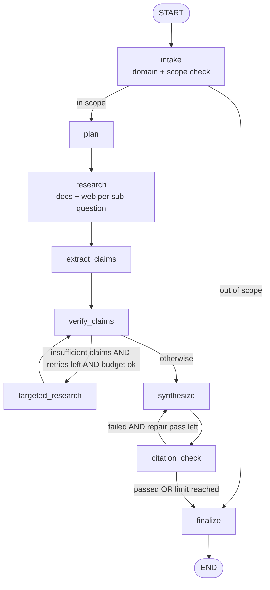
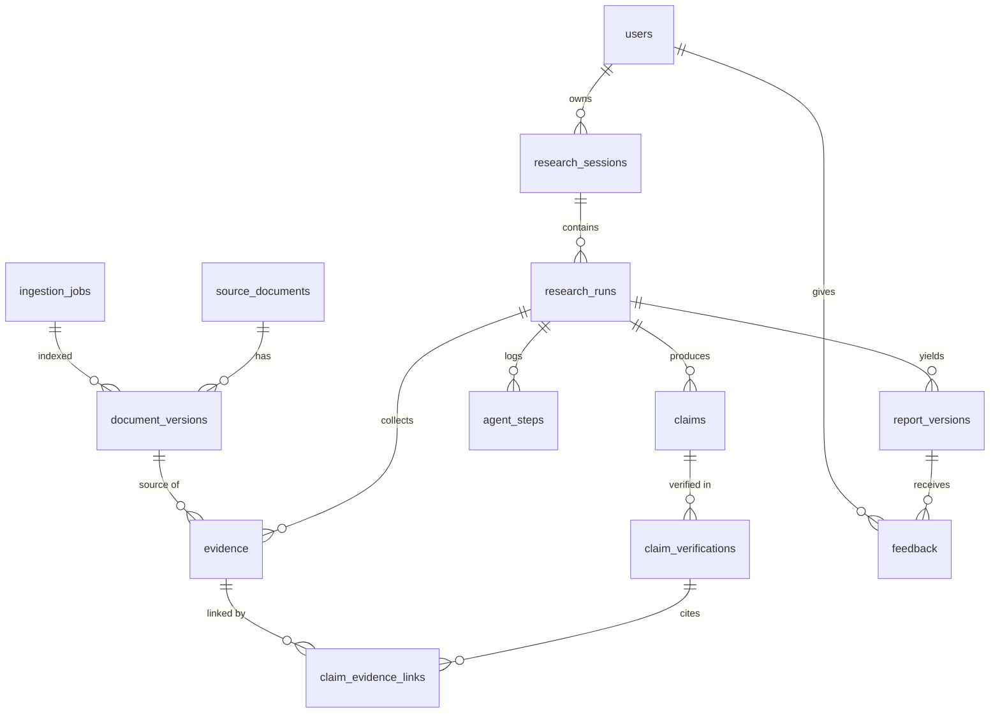

# DeepDive AI — Target Architecture

| | |
|---|---|
| **Status** | Proposed — pending review and approval |
| **Date** | 2026-10-16 |
| **Related** | [Current assessment](architecture-assessment.md) · [Technical decisions](technical-decisions.md) · [Implementation roadmap](../roadmap/implementation-roadmap.md) |

This document describes the **proposed** architecture for DeepDive AI, an enterprise-grade, self-verifying agentic research platform. Nothing here is implemented yet. Paths marked *(new)* do not exist yet. Other paths refer to existing files that would be refactored. The rationale for each choice is recorded in [technical-decisions.md](technical-decisions.md).

---

## 1. Design principles

1. **Evidence before prose.** Every statement in a report traces back to an exact quote in a specific document version, or is explicitly labelled unverified.
2. **Claim status is computed by code, not chosen by a model.** Models produce per-evidence judgments. Deterministic rules turn those into `supported` / `contradicted` / `insufficient_evidence` / `unresolved`. Model confidence scores are never an input.
3. **One workflow, many domains.** Domains are configuration (data), not separate pipelines.
4. **One door for inference.** All runtime model calls (chat, structured output, embeddings, vision) go through a single Mesh API gateway.
5. **Bounded by construction.** Retries, tool calls, LLM calls, time and cost all have explicit limits, enforced in routers.
6. **Each kind of data lives in the right place.** Orchestration state, operational records, vectors and original documents are separate tiers.
7. **Permissions come from the source.** Retrieval never returns content the requesting user couldn't read in the source system.
8. **Incremental reuse.** Existing extraction, chunking, Milvus and Streamlit code is kept and adapted.

---

## 2. Logical architecture

```
┌───────────────────────────── Streamlit UI (ui/) ─────────────────────────────┐
│ Research · History · Knowledge Sources (Uploads now, Connectors later)       │
└───────────────┬───────────────────────────────────────────────┬──────────────┘
                │ graph.stream()                                │ ingest()
┌───────────────▼──────────────────┐            ┌───────────────▼──────────────────┐
│ Research orchestration           │            │ Ingestion service                │
│ LangGraph (agents/, graph_builder)│            │ connector → normalize → extract  │
│ intake → plan → research → claims│            │ → chunk → embed → index          │
│ → verify ⇄ retry → synth → cite  │            │ (ingestion/, pdf_processing/)    │
└──────┬─────────────┬─────────────┘            └──────┬──────────────┬────────────┘
       │             │ PermissionAwareRetriever        │              │
       │             ▼                                 ▼              │
       │      ┌──────────────┐   ┌─────────────────────────┐          │
       │      │ Milvus v2    │◄──┤ Mesh gateway (gateway/) │          │
       │      │ (vectors)    │   │ chat · structured · emb │          │
       │      └──────────────┘   │ · vision                │          │
       │                         └─────────────────────────┘          │
       ▼                                                              ▼
┌──────────────────────────┐  ┌──────────────────────────┐  ┌──────────────────────┐
│ Checkpointer             │  │ Operational DB           │  │ Object store         │
│ SQLite → Postgres saver  │  │ SQLAlchemy: SQLite → PG  │  │ data/objects → GCS   │
└──────────────────────────┘  └──────────────────────────┘  └──────────────────────┘
```

**Proposed package layout.** This follows the repo's existing flat structure, with no new top-level `src/` package.

| Package | Responsibility |
|---|---|
| `config/` | Typed settings (`settings.py` *(new)*); `config.py` kept as a thin compatibility layer |
| `gateway/` *(new)* | Mesh API model gateway: the only place that creates model clients |
| `schemas/` *(new)* | Pydantic domain models: plan, claim, evidence, verification, report, documents, domain config |
| `domains/` *(new)* | Domain registry and YAML configs |
| `agents/` | LangGraph nodes, routers and `ResearchState` |
| `graph_builder/` | `build_graph(checkpointer)` factory |
| `verification/` *(new)* | Deterministic citation-integrity checks and status aggregation |
| `retriever/` | Permission-aware document search, web search tool, MMR |
| `ingestion/` *(new)* | Connector interface, upload connector, normalization, ingestion service |
| `pdf_processing/` | Extractors and chunker (reused as the extraction stage) |
| `vector_database/` | Milvus index abstraction and v2 collection schema |
| `persistence/` *(new)* | SQLAlchemy engine, models, repositories; `alembic/` migrations |
| `monitoring/` | Structured logging, usage and cost callbacks |
| `ui/` | Streamlit pages and components |
| `tests/`, `evals/` *(new)* | pytest suite and evaluation harness |

---

## 3. Research workflow (LangGraph)

### 3.1 Graph



| Node | Model use (via Mesh) | Deterministic work | Reuses |
|---|---|---|---|
| `intake` | Structured: classify intent, select or confirm domain, detect out-of-scope | Load `DomainConfig`, set budget, create run record | Guardrail idea from `supervisor_node.py` |
| `plan` | Structured: `ResearchPlan` with ≤ N sub-questions and preferred source types | Enforce limits | — |
| `research` | — | For each sub-question: permission-aware Milvus search + web search; store `Evidence` with locators | `retriever_pipeline.py`, `web_node.py` search code |
| `extract_claims` | Structured: atomic `Claim`s with suggested evidence IDs | Deduplicate; cap at `max_claims` | — |
| `verify_claims` | Structured: `EvidenceJudgment` per (claim, evidence) pair, using a **separate verifier model** | Independent retrieval per claim, quote checks, rule-based aggregation | Intent of `validation_node.py` |
| `targeted_research` | Structured: 1–2 focused queries per insufficient claim | Search, add evidence, increment `retry_round` | — |
| `synthesize` | Report text written only from `supported` claims, with `[C#:E#]` markers | Disputed and unverified section built from the other statuses | — |
| `citation_check` | — | Every marker resolves; uncited sentences flagged | — |
| `finalize` | — | Persist an immutable report version; set run status | `final_response_node.py` role |

**No model-driven tool calling in the MVP.** Nodes call retrieval tools directly, and models only produce structured output. This keeps retrieved, untrusted content away from tool execution and avoids depending on Mesh's per-model tool-calling behaviour.

### 3.2 Typed state

```python
# agents/state_node.py — replaces AgentRagState (sketch)
class Budget(BaseModel):
    max_subquestions: int = 5
    max_retry_rounds: int = 2
    max_claims: int = 25
    max_llm_calls: int = 40
    max_tool_calls: int = 30
    call_timeout_s: int = 60
    run_timeout_s: int = 300
    max_cost_usd: float | None = 0.50

class Usage(BaseModel):
    llm_calls: int = 0
    tool_calls: int = 0
    input_tokens: int = 0
    output_tokens: int = 0
    cost_usd: float | None = None      # only if Mesh reports cost (see OQ-03)
    started_at: datetime

def merge(a: dict, b: dict) -> dict:   # keyed upsert reducer
    return {**a, **b}

class ResearchState(TypedDict):
    run_id: str
    session_id: str
    user_id: str
    tenant_id: str
    query: str
    domain: DomainConfig
    source_scope: list[str]                       # e.g. ["upload:*", "web"]
    plan: ResearchPlan | None
    evidence: Annotated[dict[str, Evidence], merge]
    claims: Annotated[dict[str, Claim], merge]
    verifications: Annotated[dict[str, ClaimVerification], merge]
    retry_round: int
    budget: Budget
    usage: Usage
    events: Annotated[list[ProgressEvent], operator.add]   # UI progress feed
    errors: Annotated[list[str], operator.add]
    report: ReportDraft | None
    status: Literal["running", "completed", "partial", "failed"]
```

State holds compact objects keyed by ID. Full document text stays in Milvus and the operational database.

### 3.3 Bounds and termination

- **Routers enforce every limit.** `budget_exhausted(state)` checks call counts, elapsed time and cost. When it is true, the graph goes to `synthesize` with whatever is verified so far and ends with status `partial`.
- **Per-call limits:** `ChatOpenAI(timeout=call_timeout_s, max_retries=2)`.
- **Safety net:** `recursion_limit` is set explicitly when the graph is invoked, to about twice the expected number of steps.
- **Mesh errors:** `402 spend_limit_exceeded` and `429` after retries lead to the terminal `partial` path, never an unhandled exception.
- **Targeted retry** re-verifies only the affected claims. After the last round, remaining `insufficient_evidence` claims become `unresolved`.

### 3.4 Domain configuration

Domains are YAML files in `domains/configs/` *(new)*, validated into a Pydantic `DomainConfig` and versioned. The run records the version it used.

```yaml
# domains/configs/pharma.yaml (illustrative)
id: pharma
version: 1
name: Pharmaceutical & Biomedical Research
scope_description: Drug development, clinical evidence, regulatory status, biomedical science.
out_of_scope_examples: [personal medical advice, dosing for an individual]
planning_guidance: Prefer peer-reviewed studies, regulatory filings and labels over news.
preferred_sources: [upload, web]
web:
  allowed_domains: [pubmed.ncbi.nlm.nih.gov, fda.gov, ema.europa.eu, clinicaltrials.gov]
  blocked_domains: []
claim_types: [efficacy, safety, regulatory_status, quantity, date]
verification:
  min_independent_sources: 2
  high_risk_claim_types: [efficacy, safety]     # → needs_human_review
report:
  sections: [Summary, Evidence, Safety & Regulatory, Disputed / Unverified, Sources]
  disclaimer: Research summary only; not medical advice.
```

Initial set: `general`, `procurement`, `supply_chain`, `pharma`, `insurance`. Adding a domain means adding a file, not code.

---

## 4. Mesh API model gateway

### 4.1 Design

`gateway/mesh.py` *(new)* is the only module allowed to create model clients.

| Function | Behaviour |
|---|---|
| `chat(role)` | Returns a LangChain `ChatOpenAI` with `base_url=https://api.meshapi.ai/v1`, the Mesh key from settings, and a model chosen per role (`planner`, `extractor`, `verifier`, `synthesizer`) from configuration. Timeouts and retries are set. |
| `structured(role, schema)` | `with_structured_output(schema, method="json_schema")`. If unsupported, falls back to `function_calling`, then to JSON mode. **The result is always validated against the Pydantic schema**, because some models silently ignore `response_format`. |
| `embeddings()` | `OpenAIEmbeddings(base_url=…, model="openai/text-embedding-3-small", check_embedding_ctx_length=False)`. 1536 dimensions, which matches the existing Milvus dimension. |
| `vision(role)` | A chat model whose `input_modalities` includes images; sends `image_url` / base64 content parts. |
| `probe_capabilities()` | At startup, calls `GET /v1/models` and caches `supports_structured_output` and `input_modalities`. Fails fast if a configured model lacks a required capability. |
| Usage callback | Records model requested, model actually served, tokens, latency, and cost if returned, to `agent_steps`. |

**Enforcement.** A pytest compliance test fails if any module outside `gateway/` imports `openai`, `langchain_google_genai` or `langchain_anthropic`, or constructs `ChatOpenAI`, `OpenAIEmbeddings` or `init_chat_model`.

**When a capability is missing:** if Mesh, or the selected model, lacks something, the gateway raises a typed `CapabilityUnavailable`. The workflow then degrades in a way it records (for example, it skips image interpretation and labels it in the report). It **never** routes around Mesh to another provider.

### 4.2 Capability status

From the Mesh developer documentation, reviewed 2026-10-16. Full detail is in [technical-decisions.md §5](technical-decisions.md#5-mesh-api-capability-verification).

| Capability | Status |
|---|---|
| Auth (`Authorization: Bearer rsk_…`), OpenAI-compatible `/v1` | Documented |
| Chat completions, streaming (SSE), Responses API | Documented |
| Structured output (`json_schema` / `json_object`) | Documented; **varies by model**; silent-ignore risk |
| Tool calling | Documented page exists; not needed in the MVP |
| Embeddings (`openai/text-embedding-3-small`, 1536 dimensions) | Documented |
| Vision input (`image_url` parts) | Documented; varies by model |
| OCR / PDF input | **Not documented** |
| Rate limits / spend caps / retry & fallback | Documented qualitatively; no numeric limits |
| Data retention / privacy | **No page found**: blocker for confidential enterprise data |
| LangChain integration | Not documented; relies on OpenAI compatibility. Must be tested |

---

## 5. Claim-level evidence verification

### 5.1 Schemas

`schemas/evidence.py` *(new)*:

```python
class SourceLocator(BaseModel):
    document_id: str
    document_version_id: str
    chunk_id: str | None = None
    url: str | None = None
    page: int | None = None
    section_path: list[str] = []
    paragraph_index: int | None = None
    table_id: str | None = None
    image_id: str | None = None
    char_start: int | None = None
    char_end: int | None = None

class Evidence(BaseModel):
    evidence_id: str                    # hash(run_id, chunk_id|url, char span)
    locator: SourceLocator
    quote: str
    retrieved_via: str                  # query that surfaced it
    source_type: Literal["upload", "web", "connector"]
    retrieved_at: datetime
    content_hash: str

class Claim(BaseModel):
    claim_id: str
    text: str
    sub_question_id: str
    claim_type: str                     # from DomainConfig.claim_types
    risk: Literal["low", "high"]
    created_round: int

class EvidenceJudgment(BaseModel):      # model output, one per (claim, evidence)
    evidence_id: str
    stance: Literal["supports", "contradicts", "irrelevant"]
    supporting_quote: str
    reasoning: str

class ClaimVerification(BaseModel):
    claim_id: str
    round: int
    status: Literal["supported", "contradicted", "insufficient_evidence", "unresolved"]
    judgments: list[EvidenceJudgment]
    quote_checks: dict[str, bool]       # evidence_id → quote found in source
    rule_applied: str
    verifier_model: str
    needs_human_review: bool
```

### 5.2 Verification procedure

1. **Atomic extraction.** Each claim is a single checkable statement: one subject, one predicate, quantities and dates explicit.
2. **Independent retrieval.** Each claim is searched again using its own text, and the results are combined with the extractor's suggested evidence. The verifier therefore sees evidence the extractor didn't choose, including contradicting evidence.
3. **Per-pair judgment.** A verifier model returns one `EvidenceJudgment` per pair. Where possible it is a different model from the generator, routed via Mesh. It has no tools and sees source text only inside labelled data blocks.
4. **Integrity checks** (`verification/citation_integrity.py` *(new)*):
   - the `evidence_id` exists;
   - after normalization, `supporting_quote` is found within the stored chunk text (exact or strict fuzzy match);
   - the source is within the user's authorized scope.
   
   Judgments that fail are discarded and the reason is recorded.
5. **Aggregation** (`verification/aggregation.py` *(new)*), using the domain policy:

| Status | Rule |
|---|---|
| `supported` | ≥ `min_independent_sources` passing "supports" judgments from distinct documents (distinct registrable domains for web), and no passing "contradicts" |
| `contradicted` | ≥1 passing "contradicts" and no passing "supports" |
| `unresolved` | Passing evidence both supports and contradicts, **or** still insufficient after the final retry round |
| `insufficient_evidence` | Otherwise. This triggers targeted retry |

6. **Human review flag.** `needs_human_review = claim_type in domain.high_risk_claim_types` or the status is `contradicted` / `unresolved` in a high-risk domain.
7. **Synthesis rules.** The main narrative may use only `supported` claims. `contradicted` and `unresolved` claims appear in a "Disputed / Unverified findings" section that shows their evidence.
8. **Citation-integrity pass.** Every `[C#:E#]` marker resolves to claim → verification → evidence → locator. Sentences without markers are flagged, and one repair pass is allowed.
9. **Versioning.** Each finalized report is an immutable `report_version` that records the claim and evidence IDs it used and a content hash.

---

## 6. Multimodal research

| Capability | MVP | Post-MVP |
|---|---|---|
| Text PDFs | PyMuPDF per page, plus block offsets so locators can carry `char_start/char_end` and a best-effort `section_path` from font-size headings | Layout-aware sectioning |
| Tables | Camelot tables converted to Markdown and indexed as `element_type=table` chunks, with `table_id` and page | Table-structure question answering |
| Images & charts | Extracted and stored with page metadata (not interpreted) | Captioning and chart reasoning via a Mesh vision model; captions indexed as `element_type=image_caption` with `image_id` |
| Scanned PDFs | Detected (pages with no text layer) and reported as "not searchable" | Page rendered to PNG → Mesh vision transcription, **subject to OQ-02** |
| Missing capability | `CapabilityUnavailable` → content marked unprocessed; the report notes the gap | Same |

Extraction metadata (extractor name and version, method, timestamp) is stored on `document_versions` for traceability.

---

## 7. Enterprise ingestion architecture

### 7.1 Layers

```
SourceConnector → Normalizer → Extractor(s) → Chunker → Embedder (Mesh) → VectorIndex (Milvus)
        │              │                                                        │
        └──────────── MetadataStore (SQL: documents, versions, ACLs, jobs) ◄────┘

Retrieval:  PermissionAwareRetriever(VectorIndex, MetadataStore, principal)  →  research nodes
```

Each layer talks to the next only through its interface. The research graph sees only `PermissionAwareRetriever` and `source_scope`, never a connector. Adding a connector therefore needs no change to the workflow.

### 7.2 Connector interface

`ingestion/connectors/base.py` *(new)*:

```python
class ConnectorCapabilities(BaseModel):
    delta_sync: bool
    native_acl: bool
    versioning: bool
    webhooks: bool

class SourceContainer(BaseModel):         # site, drive, bucket, space, folder
    source_system: str
    container_id: str
    display_name: str

class SourceItemRef(BaseModel):
    source_system: str
    external_id: str
    uri: str | None
    etag_or_version: str | None
    modified_at: datetime | None

class ChangeSet(BaseModel):
    upserts: list[SourceItemRef]
    deletions: list[SourceItemRef]
    next_cursor: str | None

class DocumentACL(BaseModel):
    principals: list[str]                 # "user:<id>", "group:<id>"
    inherited_from: str | None = None

class SourceConnector(Protocol):
    system: str
    capabilities: ConnectorCapabilities
    def discover(self, config: ConnectorConfig) -> Iterable[SourceContainer]: ...
    def full_listing(self, container: SourceContainer) -> Iterable[SourceItemRef]: ...
    def changes_since(self, container: SourceContainer, cursor: str | None) -> ChangeSet: ...
    def fetch(self, ref: SourceItemRef) -> RawDocument: ...       # stream + native metadata
    def get_acl(self, ref: SourceItemRef) -> DocumentACL: ...
```

How the interface covers each requirement:

| Requirement | Mechanism |
|---|---|
| Discovery / enumeration | `discover`, `full_listing` |
| Full and incremental sync | `full_listing` vs `changes_since(cursor)`; cursor stored on `ingestion_jobs` |
| Change detection | Delta tokens where supported; otherwise `modified_at` + `etag` + content hash |
| Updates and deletions | `ChangeSet.deletions` → vectors deleted or deactivated by `document_id`; SQL status `deleted` |
| Stale-index prevention | A new `document_version` deactivates the previous version's vectors (`is_active=false`) before the new version is activated |
| Stable provenance IDs | `document_id = sha256(tenant, source_system, external_id)`; `version_id = sha256(content)` |
| Permission-aware retrieval | ACL fetched per item and stored in SQL and on every chunk |
| Authentication | Each connector holds a `CredentialRef` (Secret Manager name), never a raw secret |
| Job status, retry, resume | `ingestion_jobs` + per-version `index_status`; the service skips versions already indexed |
| Consistent representation | `Normalizer` → `NormalizedDocument` (title, MIME type, URI, timestamps, ACL, source metadata) |

### 7.3 MVP minimum

Only these are built in the MVP:

- `base.py`
- `LocalUploadConnector` (`ingestion/connectors/local_upload.py` *(new)*), which wraps the current upload flow:
  - `document_id = sha256(tenant, "upload", uploader_id, original_filename)`; `version_id = sha256(bytes)`
  - re-uploading identical bytes does nothing; changed bytes create a new version and the previous one is deactivated
  - ACL = `["user:<uploader_id>"]`, never public by default
  - original files stored by content hash under `data/objects/` (later GCS)
- `normalize.py`, `service.py` (an `IngestionService` that runs extract → chunk → embed → index and records `ingestion_jobs`)
- `vector_database/milvus_index.py` with the v2 schema

### 7.4 SharePoint connector (illustrative interface; **not** built in the MVP)

```python
class SharePointConnector(SourceConnector):
    system = "sharepoint"
    capabilities = ConnectorCapabilities(delta_sync=True, native_acl=True, versioning=True, webhooks=True)

    def __init__(self, credentials: CredentialRef, approved_sites: list[str]):
        # MSAL client-credentials flow; Microsoft Graph application permission
        # Sites.Selected (per-site grant) rather than tenant-wide Sites.Read.All.
        ...

    def discover(self, cfg):              # GET /sites/{site-id}/drives   (approved sites only)
        ...
    def full_listing(self, container):    # GET /drives/{drive-id}/root/delta (initial)
        ...
    def changes_since(self, container, cursor):  # GET /drives/{drive-id}/root/delta?token={cursor}
        ...
    def fetch(self, ref):                 # GET /drives/{drive-id}/items/{item-id}/content (+ eTag)
        ...
    def get_acl(self, ref):               # GET /drives/{drive-id}/items/{item-id}/permissions
        ...                               # → Entra ID user/group object IDs
```

The Graph endpoint and permission details must be checked against Microsoft documentation when the connector is actually built.

### 7.5 Ingestion security

- **Permissions are never bypassed.** The connector's service identity is used only to read. Retrieval always filters by the **requesting user's** principals, never by the connector's.
- **Two checks:**
  1. Milvus pre-filter `tenant_id == T and is_active and array_contains_any(acl_principals, user_principals)`;
  2. a post-retrieval re-check against the SQL ACL before evidence enters graph state.
- **ACLs refresh on every sync.** A permission change is processed as a change event. Group membership is resolved from the identity provider and cached with a short time limit. For high-sensitivity sources, a live check against the source at query time can be added later.
- **Least privilege.** Read-only scopes, per-site or per-bucket grants, credentials in Secret Manager, and admin approval of each connected container.
- **Deletions propagate.** A source deletion removes or deactivates vectors and marks the document deleted. Past reports keep their frozen quote snapshot, flagged "source since deleted".
- **Indexing never widens access.** Documents are indexed only with the ACL that came from their source.

---

## 8. Persistence architecture

### 8.1 Four tiers

| Tier | Holds | MVP | Production | System of record |
|---|---|---|---|---|
| **LangGraph checkpoints** | In-progress graph state for resume, `interrupt()` and debugging | `SqliteSaver`, separate file `data/checkpoints.sqlite`; `thread_id = run_id` | `PostgresSaver` (Cloud SQL, separate schema) | **No**: can be purged after a retention period |
| **Operational DB** | Sessions, runs, documents, claims, evidence, verifications, reports, feedback, steps | SQLAlchemy 2 + Alembic on `data/deepdive.db` | Cloud SQL PostgreSQL | **Yes** |
| **Vector DB** | Chunk embeddings, chunk text, filter metadata | Milvus / Zilliz Cloud | Same (managed) | No: can be rebuilt from documents |
| **Object store** | Original files, extracted tables and images | `data/objects/` | GCS, prefixed per tenant | Yes, for raw content |

**Keeping orchestration and records separate.** Nodes stay pure: they return state updates. A thin repository layer (`persistence/repositories.py` *(new)*) writes operational records at node boundaries. It uses deterministic IDs and upserts, so replaying a node after resuming from a checkpoint never creates duplicates. The UI reads history only from the operational database, never from checkpoints.

### 8.2 Minimum viable relational model

Every key table has a `tenant_id` column (default `"default"`). There is no `tenants` table in the MVP.



| Table | Key columns |
|---|---|
| `users` | id, tenant_id, email, display_name, role, created_at |
| `research_sessions` | id, tenant_id, user_id, title, domain_id, created_at |
| `research_runs` | id, tenant_id, session_id, query, domain_id, domain_config_version, `plan_json` (with revisions), budget_json, status, total tokens, total cost, latency, checkpoint_thread_id, started_at, ended_at |
| `source_documents` | id (stable), tenant_id, source_system, external_id, uri, title, mime_type, owner_user_id, `acl_json`, status (active/deleted), created_at, updated_at |
| `document_versions` | id (content hash), document_id, ingestion_job_id, storage_uri, page_count, extractor_versions, embedding_model, index_status, is_current, created_at |
| `ingestion_jobs` | id, tenant_id, connector_type, mode (upload/full/incremental), cursor, status, counts_json, error, started_at, ended_at |
| `evidence` | id, run_id, document_version_id, chunk_id, url, locator_json, quote, retrieved_via, content_hash, retrieved_at |
| `claims` | id, run_id, text, claim_type, risk, sub_question_id, created_round, latest_status |
| `claim_verifications` | id, claim_id, round, status, rule_applied, reasoning, verifier_model, needs_human_review, created_at |
| `claim_evidence_links` | verification_id, evidence_id, stance, quote_verified |
| `agent_steps` | id, run_id, node, retry_round, status, started_at, ended_at, model_requested, model_served, input_tokens, output_tokens, cost, tool_calls, error |
| `report_versions` | id, run_id, session_id, version, markdown, structured_json, claim_ids, evidence_ids, content_hash, created_at |
| `feedback` | id, tenant_id, report_version_id, claim_id (nullable), user_id, rating, label, comment, created_at |

**Deliberately deferred:**

- `tenants`
- `connector_configs` (connector type, containers, `credential_ref` to Secret Manager, schedule, cursor)
- `evaluation_results` (MVP eval output is JSON files)
- `audit_events` (append-only, hash-chained)
- `document_chunks`
- a separate `research_plans` table (`plan_json` covers plans in the MVP)

### 8.3 Milvus v2 collection

Create a **new** collection, `deepdive_chunks_v1`, and leave `ai_research_assistant` untouched.

| Field | Type | Purpose |
|---|---|---|
| `chunk_id` | VARCHAR (PK) | `sha256(document_version_id, element_index, chunk_index)` |
| `embedding` | FLOAT_VECTOR(1536) | Mesh `openai/text-embedding-3-small` |
| `text` | VARCHAR | Chunk text |
| `tenant_id` | VARCHAR (partition key) | Tenant isolation |
| `document_id`, `document_version_id` | VARCHAR | Provenance, deletion, versioning |
| `source_system` | VARCHAR | upload / sharepoint / … |
| `page`, `section`, `element_type` | INT64 / VARCHAR / VARCHAR | Locators; text / table / image_caption |
| `char_start`, `char_end` | INT64 | Quote location |
| `acl_principals` | ARRAY<VARCHAR> | Permission pre-filter |
| `is_active` | BOOL | Stale-index prevention |
| `embedding_model` | VARCHAR | Re-embedding safety |

The HNSW index is created once, at collection creation (reuses `IndexManager.create_hnsw_index`). All chunks are re-embedded through Mesh rather than reusing the existing vectors, which were made by calling OpenAI directly. Array fields and `ARRAY_CONTAINS_ANY` need Milvus 2.4+ ([OQ-04](technical-decisions.md#4-open-questions)).

### 8.4 SQLite → PostgreSQL migration

- **Portable SQLAlchemy types only:** `JSON` (JSONB on PostgreSQL through a type variant), string UUIDs, timezone-aware `DateTime`, no SQLite-only SQL.
- **Alembic from the first schema commit**, with `render_as_batch=True` for SQLite.
- **The database URL comes from settings:** `sqlite:///data/deepdive.db` → `postgresql+psycopg://…` through the Cloud SQL Python Connector or Auth Proxy.
- **CI runs repository tests on SQLite and on a PostgreSQL container.**
- **Moving data:** a one-off export/import script for anything worth keeping. For hackathon data, re-ingestion is acceptable.

### 8.5 Provenance and audit trail

Each report version links to claims, then verifications, then evidence. Evidence stores a frozen quote and content hash and points to a document version with its storage path and content hash.

In addition:

- `research_runs` records the domain config version, budget and plan.
- `agent_steps` records the model actually served (Mesh may retry or fall back) and per-step usage.
- Report versions are never updated in place.
- Post-MVP, `audit_events` adds a hash-chained log of security-relevant actions (uploads, deletions, connector changes, report approvals).

---

## 9. Streamlit experience

[ui/streamlit_app.py](../../ui/streamlit_app.py) becomes the multipage entry point (`st.navigation`). [app.py](../../app.py) shrinks to a small wrapper.

**Research page** (`ui/pages/research.py` *(new)*):

- **Sidebar:** domain selector; **Sources** multiselect built from a `SourceScope` registry (MVP: "My uploads", "Web"); uploader.
- **Progress:** `graph.stream(stream_mode="updates")` feeding an `st.status` panel that shows plan size, current node, claims verified and the retry round.
- **Result tabs:**
  1. **Report**, with citation chips;
  2. **Claims**: a table with status badges, filters and review flags;
  3. **Evidence**: expanders with title, page and section, the verified quote highlighted, and the link;
  4. **Audit**: steps, retries, models served, tokens, cost and latency.
- **Downloads:** Markdown and JSON via `st.download_button`. PDF export is a stretch goal.

**History page:** sessions and report versions from the database, with feedback on reports and individual claims.

**Knowledge Sources page:**

- **MVP:** an Uploads tab with document list, version, index status and delete.
- **Later:** a Connectors tab, and an admin-only Connector Admin section, behind feature flags.

**Why the UI needs no redesign for connectors.** Connectors only register `SourceScope` entries, which appear in the existing multiselect, and add rows and tabs to the Knowledge Sources page.

---

## 10. Security and governance

| Area | Control |
|---|---|
| Secrets | `.env` locally (with a committed `.env.example`); GCP Secret Manager in production; never write secrets to `os.environ` at runtime or into logs |
| Identity | MVP: single local user, `tenant_id="default"`. Later: IAP or OIDC (Entra ID / Google) mapped to `users`, with group claims for ACLs |
| Authorization | All repository queries scoped by tenant and user; permission-aware retrieval (§7.5) |
| Prompt injection | Retrieved content goes only into labelled data blocks; system prompts say to ignore instructions inside the data; no tools for extractor or verifier; per-domain web allow and block lists; deterministic quote checks; model output rendered as Markdown without `unsafe_allow_html` |
| Uploads | File-signature (magic byte) and MIME checks; size and page limits; store by content hash; reject encrypted or malformed PDFs cleanly |
| Sensitive data | Log IDs only, not content; LangSmith **off by default** (if enabled, mask inputs and outputs, or restrict it to non-confidential datasets); Mesh data-handling terms must be confirmed before confidential use ([OQ-05](technical-decisions.md#4-open-questions)) |
| Human review | `needs_human_review` flag shown in the MVP; post-MVP LangGraph `interrupt()` approval before a report is finalized in high-risk domains |
| Tenant isolation (SaaS) | `tenant_id` everywhere; PostgreSQL row-level security; Milvus partition key (or a collection per tenant for regulated customers); GCS prefix + IAM conditions; optional per-tenant encryption keys (CMEK) |
| Supply chain | Pinned dependencies, unused packages removed, dependency vulnerability scanning in CI |

---

## 11. Observability and evaluation

- **Logging:** JSON lines carrying `run_id`, `node`, `tenant_id` and an event name, to stdout in containers.
- **Execution records:** an `agent_steps` row per node execution, including retry round, model served, tokens, latency, tool calls and errors.
- **Traces:** LangSmith optional, behind configuration; LangGraph stream events drive the UI progress panel.
- **Evaluation harness** (`evals/` *(new)*): about 10 cases per domain with seeded documents containing known true, false and absent facts. Metrics:
  - claim-status precision and recall against labels;
  - citation accuracy (quote present in the source and supporting the claim);
  - unsupported-claim rate in the final narrative (target 0);
  - retry yield (claims recovered per round);
  - cost and latency per run.
- **Tests (pytest):**
  - unit tests for routers and bounds, aggregation rules, quote checks, ID determinism and connector idempotency;
  - repository tests on in-memory SQLite;
  - graph tests with a fake chat model and an in-memory vector index;
  - the Mesh compliance test;
  - `@pytest.mark.live` integration tests for Mesh and Milvus.

---

## 12. Deployment

| Stage | Approach |
|---|---|
| Local MVP | Python venv, `.env`, SQLite files under `data/`, Zilliz Cloud (or Milvus Lite for offline tests, pending check of array-filter support), `streamlit run` |
| Container | Single Dockerfile; Streamlit on port 8080; config from environment only; no state written inside the image |
| GCP production (future) | Cloud Run (session affinity, min instances ≥1 for Streamlit websockets) · Cloud SQL PostgreSQL · GCS for documents · Secret Manager · Cloud Run Jobs or Cloud Tasks for background ingestion · Zilliz Cloud for vectors |
| Other clouds | Cloud Run is GCP-only. Equivalents: AWS App Runner or ECS Fargate + RDS + S3 + Secrets Manager; Azure Container Apps + Azure Database for PostgreSQL + Blob + Key Vault |
| Managed vector options | Keep Zilliz Cloud (managed Milvus). Consider Vertex AI Vector Search or pgvector only if consolidation or compliance justifies a migration |

> **SQLite and container-local storage are not suitable for production on Cloud Run.** Instance filesystems are temporary and not shared between instances, so the database, checkpoints and uploaded documents would be lost or inconsistent. Production must use Cloud SQL and GCS.
